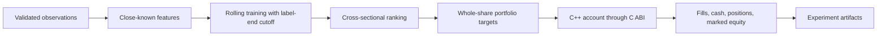

# Architecture

Python owns data preparation, model fitting, ranking and experiment reporting. C++ owns deterministic account transitions and execution primitives. The public example retrains every signal day and trades two synthetic names. It is an integration example; the original 500-stock research had model-specific holding policies and multiple virtual sleeves.

## Native boundary

`cpp/include/hybrid_quant/core.hpp` defines the C ABI. `src/hybrid_quant/native.py` declares argument and return types and converts native rejection codes to Python exceptions. Account handles are released by a context manager. Building against the current source avoids distributing a stale DLL with a mismatched wrapper.

Cash, position quantities, cost basis and realized PnL are native state. Marks affect unrealized equity, while orders change cash and quantity. Native tests exercise affordability, invalid orders, fills, splits, dividends and order lifecycle where supported. No claim is made about concurrent access to one account handle: callers must serialize mutations.

## Execution assumptions

The demo targets 95% gross exposure to reserve cash for costs, rounds quantities down and processes reductions before purchases. Orders use next-session opening prices plus explicit slippage and commissions. It uses synthetic complete observations and immediate fills; the resting-limit/partial-fill primitives are tested separately. Closing prices mark end-of-session equity after execution.

The demo is small enough to inspect. Larger runs should partition by symbol/session, cache immutable features, checkpoint fitted windows and benchmark the actual workload before introducing concurrency. No throughput or latency benchmark has been established in this release.
